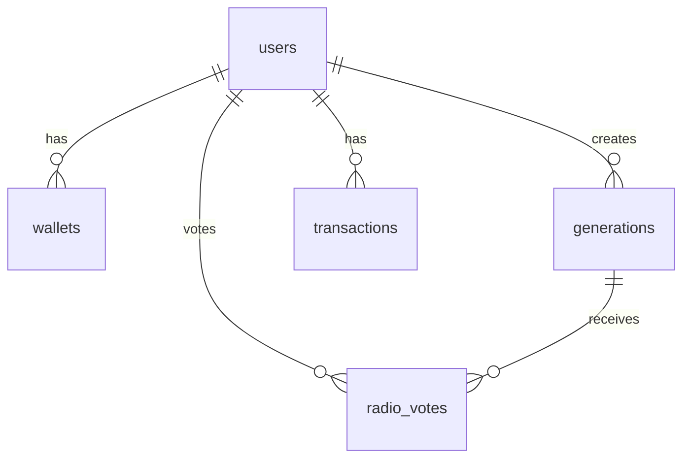

# Инфраструктура и DevOps

## Docker Compose

### Сервисы

**PostgreSQL 16**
- Порт: `5432`
- Credentials: `riffa:riffa`
- Database: `riffa`
- Volume: `pgdata`

**Redis 7**
- Порт: `6379`
- Использование: кеш, очередь Arq

**MinIO**
- API: `9000`
- Console: `9001` (minioadmin/minioadmin)
- Bucket: `riffa-media`
- Volume: `miniodata`

### Команды

```bash
# Запуск всех сервисов
docker-compose up -d

# Проверка статуса
docker ps

# Логи
docker-compose logs -f

# Остановка
docker-compose down
```

## База данных

### Миграции Alembic

**История миграций:**
- `001` — начальная схема (users, wallets, generations, transactions)
- `002` — share/rating (is_public, published_track_index)
- `003` — radio (radio_votes, денормализованные счётчики)
- `004` — password_hash VARCHAR(128)

**Команды:**
```bash
cd backend
alembic upgrade head          # применить все миграции
alembic revision -m "name"    # создать новую
alembic downgrade -1          # откатить последнюю
```

### Схема БД



## Скрипты запуска

### `start-all.ps1` (основной)

**Что делает:**
1. ✅ Проверяет Docker, venv, node_modules
2. 🐳 Поднимает PostgreSQL/Redis/MinIO
3. 🧹 Убивает зомби-процессы
4. 🚀 Стартует Backend + Worker + Frontend
5. 🎨 Цветные логи: `[BACK]` `[WORK]` `[FRONT]`
6. ⛔ Ctrl+C → корректная остановка

**Использование:**
```powershell
.\start-all.ps1
```

### `start-dev.ps1` (первый запуск)

**Для новой машины (один раз):**
```powershell
.\start-dev.ps1
```

Создаёт venv, устанавливает зависимости, применяет миграции.

## Порты

| Сервис | Порт | URL |
|--------|------|-----|
| Frontend | 5173 | http://localhost:5173 |
| Backend | 8000 | http://localhost:8000 |
| API Docs | 8000 | http://localhost:8000/docs |
| PostgreSQL | 5432 | localhost:5432 |
| Redis | 6379 | localhost:6379 |
| MinIO API | 9000 | http://localhost:9000 |
| MinIO Console | 9001 | http://localhost:9001 |

## Логирование

### Backend logs
- **Uvicorn:** stdout (через start-all.ps1)
- **Suno payload:** `backend/logs/generations.log`
  - Ротация: 10MB, 7 дней
  - Формат: JSON dump каждого запроса к Suno

### Worker logs
- **Arq:** stdout (через start-all.ps1)
- Префикс: `[WORK]`

## Troubleshooting

### Docker не запускается
```powershell
# Проверить статус Docker Desktop
docker ps

# Перезапустить Docker Desktop
# Пуск → Docker Desktop → Restart
```

### Зомби-процессы
```powershell
# start-all.ps1 автоматически убивает их
# Вручную:
taskkill /F /IM python.exe
taskkill /F /IM node.exe
```

### База данных не подключается
```bash
# Проверить контейнер
docker ps | grep postgres

# Проверить логи
docker logs riffaweb5-db-1

# Пересоздать
docker-compose down
docker-compose up -d db
```

См. также: [[42-Troubleshooting|Полный гайд по решению проблем]]
